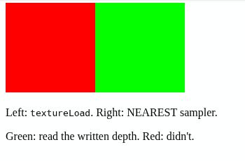

# [gles] textureLoad from a depth texture returns 0 on WebGL2

https://github.com/gfx-rs/wgpu/issues/10878

## Description

On WebGL2, `textureLoad`ing a `Depth32Float` bound as an unfilterable `texture_2d<f32>` always returns **0** (no validation errors). 

The same shader works on Vulkan and desktop GL.

Reading via a `NEAREST` non-comparison sampler returns the right value on every backend.

## Reproduction

We write depth 0.5 into a 1×1 `Depth32Float`, then read it back twice onto two halves of the viewport:

- **left:** `textureLoad(depth, vec2<i32>(0, 0), 0).r`
- **right:** `textureSampleLevel(depth, nearest, vec2<f32>(0.5), 0.0).r` with a `NEAREST` non-comparison sampler

We paint a read of 0.5 as **green**, anything else as **red**.

### Web

```sh
cargo build --release --target wasm32-unknown-unknown
wasm-bindgen target/wasm32-unknown-unknown/release/wgpu-webgl-depth-repro.wasm --out-dir web/pkg --out-name wgpu_webgl_depth_repro --web
# then serve web/ and open index.html
```

Or with Nix:
```sh
nix run # serves on port 8000
```

### Native
Only prints whether both halves are green.

```sh
cargo run                    # Vulkan
WGPU_BACKEND=gl cargo run    # desktop GL
```

Or with Nix:
```sh
nix develop
cargo run
```

## Cause

`wgpu-hal`'s GL `create_texture` (https://github.com/gfx-rs/wgpu/blob/852d819c41a0b178aa1a4681bf1e0503bb90ca39/wgpu-hal/src/gles/device.rs#L929) sets `NEAREST` filters for certain formats, but doesn't include depth textures:

```rust
match desc.format.sample_type(None, Some(self.shared.features)) {
    Some(
        wgt::TextureSampleType::Float { filterable: false }
        | wgt::TextureSampleType::Uint
        | wgt::TextureSampleType::Sint,
    ) => {
        // reset default filtering mode
        unsafe {
            gl.tex_parameter_i32(target, glow::TEXTURE_MIN_FILTER, glow::NEAREST as i32)
        };
        unsafe {
            gl.tex_parameter_i32(target, glow::TEXTURE_MAG_FILTER, glow::NEAREST as i32)
        };
    }
    _ => {}
}
```

Depth textures keep the linear default, which breaks certain texture completeness rules only on GLES 3.0 (and so WebGL2) (see last bullet of [GLES 3.0.6 "Texture Completeness"](https://registry.khronos.org/OpenGL/specs/es/3.0/es_spec_3.0.pdf#page=174)).

## Results

| Backend | `textureLoad` | `NEAREST` sampler |
|---|---|---|
| Vulkan | ok | ok |
| GL 4.6 | ok | ok |
| WebGL2 | **reads 0** | ok |



## Platform

- Intel Arc (Meteor Lake), Mesa 26.1.8
- NixOS 26.05
- wgpu 30.0.1, wgpu-hal 30.0.1, naga 30.0.1
- wasm-bindgen 0.2.130
- Chromium 153